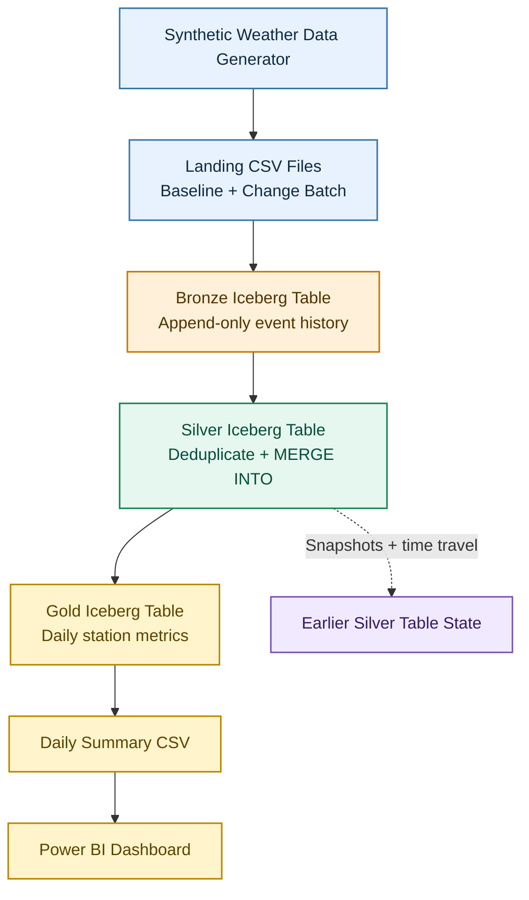

<div align="center">

# 🌦️ End-to-End Apache Iceberg Weather Lakehouse

### A portfolio-ready data engineering project built with PySpark, Apache Spark, and Apache Iceberg


**Preserve incoming events. Resolve changing data. Query history. Deliver analytics.**

</div>

---

## 📌 Project Overview

Weather data pipelines have to deal with more than clean, perfectly ordered records. The same observation may arrive more than once, a station may correct a reading, and an observation may arrive after its original date.

This project builds an **end-to-end weather lakehouse using Apache Iceberg** to demonstrate how those changes can be handled while keeping the analytical output accurate and making earlier table states available for inspection.

The pipeline follows a **Bronze → Silver → Gold** design:

- **Bronze** preserves incoming weather events, including repeated deliveries and corrections.
- **Silver** maintains one current observation for each station and observation timestamp.
- **Gold** produces daily weather metrics for analysis and dashboarding.

> ℹ️ **Dataset note:** all weather measurements are synthetic data generated locally for this project. They are not live readings from real weather stations.

## 🧭 Quick Navigation

| Section | What you'll find |
|---|---|
| [Problem & Architecture](#-problem--architecture) | The data problem and end-to-end flow |
| [Iceberg Features](#-apache-iceberg-features-demonstrated) | What the project actually implements |
| [Tech Stack](#-tech-stack) | Tools and versions |
| [Repository Guide](#-repository-guide) | Application and supporting files |
| [Run the Project](#-run-the-project) | Recommended execution order |
| [Validation Results](#-validation-results) | Expected counts and scenarios demonstrated |
| [Power BI Output](#-power-bi-output) | Using the Gold summary in a dashboard |

---

## 🎯 The Problem We're Solving

Imagine that a weather station sends an observation, then a corrected version arrives later. Another observation is delivered twice. Meanwhile, a reading from an earlier day shows up late.

A reliable pipeline should be able to:

| Challenge | What the pipeline needs to do |
|---|---|
| Duplicate deliveries | Preserve received events in Bronze while keeping a single current row in Silver |
| Corrected observations | Update the current observation when a newer revision arrives |
| Late-arriving data | Add the observation to the correct historical station/date and refresh the daily metrics |
| Historical inspection | Query an earlier Iceberg snapshot to see the table state before a change |
| Reliable analytics | Recalculate daily summaries from the current Silver state |

The goal is not simply to move a CSV through three folders. It is to demonstrate how a table format such as **Apache Iceberg** can support a lakehouse pipeline where data changes over time.

## 🏗️ Problem & Architecture

The full flow is shown below. GitHub renders this Mermaid diagram directly in the README.



### 🔄 Pipeline Flow

<details>
<summary><strong>01 · Generate the synthetic input data</strong></summary>

A Python helper creates hourly weather observations for eight fictional stations, plus a small change batch designed to simulate a correction, duplicate deliveries, and a late observation. The validated demonstration uses **2024**, a leap year.

</details>

<details>
<summary><strong>02 · Bronze — preserve incoming events</strong></summary>

The ingestion application writes source events to an Iceberg Bronze table. The raw event history keeps repeated deliveries instead of silently overwriting them.

</details>

<details>
<summary><strong>03 · Silver — maintain the current state</strong></summary>

The Silver application validates and deduplicates input records by `(station_id, observed_at)`. It uses revision and ingestion-time ordering to choose the winning record, then applies an Iceberg `MERGE INTO` to insert new observations or update the current version.

Iceberg does not automatically enforce business-key uniqueness; that rule is implemented in the pipeline logic.

</details>

<details>
<summary><strong>04 · Gold — create analytics-ready data</strong></summary>

The Gold application aggregates the current observations by station and calendar date, refreshes the daily summary Iceberg table, and exports a CSV for Power BI. The CSV is a BI hand-off; the Gold Iceberg table remains part of the lakehouse.

</details>

---

## ❄️ Apache Iceberg Features Demonstrated

This project focuses on a practical set of Iceberg capabilities and shows how they fit into a data pipeline.

| Feature | How it is used in this project |
|---|---|
| **Iceberg tables and catalog** | Store Bronze, Silver, and Gold as Iceberg tables through Spark's Iceberg catalog |
| **Append commits** | Add incoming events to the Bronze table without losing repeated deliveries |
| **`MERGE INTO` / upserts** | Update corrected observations and insert newly arriving observations into Silver |
| **Partitioning** | Organize the current-state and daily-summary tables using monthly partitioning |
| **Snapshot history** | Inspect committed table snapshots through Iceberg metadata tables |
| **Metadata tables** | Query `.snapshots` to inspect snapshot IDs, operations, and commit history |
| **Time travel** | Query a saved Silver snapshot to retrieve the pre-correction value |
| **Gold refresh** | Recompute daily analytics from the updated Silver table and commit the refreshed Gold state |

<details>
<summary><strong>What this project does not claim to demonstrate</strong></summary>

This version does **not** include dedicated demonstrations of schema evolution, partition evolution, compaction, snapshot expiration, branches/tags, rollback/recovery, Kafka streaming, or Airflow orchestration. Those are separate concepts and are intentionally outside the scope of this focused project.

</details>

---

## 🧰 Tech Stack

| Technology | Role |
|---|---|
| **Apache Iceberg 1.9.2** | Table format, commits, snapshot history, metadata queries, and time travel |
| **Apache Spark 3.5.1** | Distributed execution engine |
| **PySpark** | Data ingestion, validation, deduplication, merges, and aggregation |
| **Python standard library** | Generate deterministic synthetic CSV input |
| **Spark SQL** | Inspect the tables and verify pipeline behavior |
| **Docker / Docker Compose** | Run the local Spark environment |
| **Power BI Desktop** | Visualize the exported Gold summary |

### 🗃️ Iceberg Tables

| Layer | Table | Responsibility |
|---|---|---|
| 🟤 Bronze | `local.weather_demo.bronze_events` | Append-only history of received weather events |
| ⚪ Silver | `local.weather_demo.silver_observations` | One current observation per `(station_id, observed_at)` key |
| 🟡 Gold | `local.weather_demo.gold_daily_summary` | One analytical record per station and calendar date |

**Warehouse location inside the Spark environment:** `/opt/iceberg/warehouse/weatherledger_project`

---

## 📂 Repository Guide

The repository includes the application programs, SQL inspection queries, infrastructure configuration, and a command-reference file for running the project.

```text
.
└── apps/
    └── weatherledger_project/
        ├── generate_demo_data.py          # Creates the baseline and change CSV files
        ├── bronze_ingest.py               # Appends incoming events to Bronze
        ├── silver_upsert.py                # Validates, deduplicates, and MERGEs into Silver
        ├── gold_analytics.py               # Builds daily analytics and exports the CSV
        └── sql/
            └── inspection_queries.sql      # Validation, history, time travel, and Gold queries
```

Alongside the application folder, the repository includes the Docker/Spark/Iceberg infrastructure configuration and a command-reference file with the data-generation and `spark-submit` invocations. Use the mounts defined in those files when running the commands.

### 🧪 Application Responsibilities

<details>
<summary><strong><code>generate_demo_data.py</code></strong></summary>

Generates reproducible synthetic weather input: a baseline batch and a small follow-up batch containing a corrected observation, duplicate deliveries, and a late-arriving observation. **[Open the generator source](apps/weatherledger_project/generate_demo_data.py).**

</details>

<details>
<summary><strong><code>bronze_ingest.py</code></strong></summary>

Reads the next available input batch and appends its events to `local.weather_demo.bronze_events`. The baseline is ingested first; the change batch is ingested later. **[Open the Bronze application](apps/weatherledger_project/bronze_ingest.py).**

</details>

<details>
<summary><strong><code>silver_upsert.py</code></strong></summary>

Builds the current-state Silver table from the Bronze events. It selects the appropriate record for each station/timestamp key and uses `MERGE INTO` to apply changes without creating duplicate current-state keys. **[Open the Silver application](apps/weatherledger_project/silver_upsert.py).**

</details>

<details>
<summary><strong><code>gold_analytics.py</code></strong></summary>

Aggregates Silver into daily station-level metrics, refreshes `local.weather_demo.gold_daily_summary`, and writes the Power BI CSV export. **[Open the Gold application](apps/weatherledger_project/gold_analytics.py).**

</details>

<details>
<summary><strong><code>sql/inspection_queries.sql</code></strong></summary>

Contains prepared queries to check row counts, inspect duplicate deliveries, compare current observations before and after changes, inspect snapshot history, perform time travel, and validate the Gold metrics. Iceberg snapshot IDs are generated at runtime, so use the ID captured from your own run in the time-travel query. **[Open the SQL inspection queries](apps/weatherledger_project/sql/inspection_queries.sql).**

</details>

---

## 🚀 Run the Project

> **Important:** this repository is designed for the included local Docker/Spark setup. Start the containers and verify the mounted paths and Iceberg runtime JAR using the supplied infrastructure and command-reference files before submitting the applications.

### Prerequisites

- Docker Desktop with Docker Compose
- The project infrastructure files and required Spark containers running
- Apache Spark **3.5.1**
- Apache Iceberg runtime **1.9.2** available inside the Spark containers
- The mounted application and data directories used by the included commands

The configured Iceberg runtime JAR path in the container is:

```text
/opt/iceberg-jars/iceberg-spark-runtime-3.5_2.12-1.9.2.jar
```

The Spark commands configure the Iceberg Spark SQL extensions, a Hadoop-backed Spark catalog named `local`, the project warehouse, and the UTC session timezone. Keep these settings consistent across the three applications.

### Recommended Execution Order

1. **Start the infrastructure** using the supplied Docker/Spark setup.
2. **Generate the synthetic input files** with [`generate_demo_data.py`](apps/weatherledger_project/generate_demo_data.py).
3. **Load the baseline batch** by running [`bronze_ingest.py`](apps/weatherledger_project/bronze_ingest.py).
4. **Build the initial current state** by running [`silver_upsert.py`](apps/weatherledger_project/silver_upsert.py).
5. **Build the initial daily summary** by running [`gold_analytics.py`](apps/weatherledger_project/gold_analytics.py).
6. Use [`inspection_queries.sql`](apps/weatherledger_project/sql/inspection_queries.sql) to inspect Bronze, Silver uniqueness, and the current summary. Save the current Silver snapshot ID before processing the changes.
7. **Ingest the change batch** by running [`bronze_ingest.py`](apps/weatherledger_project/bronze_ingest.py) again.
8. **Apply the correction and late event** by running [`silver_upsert.py`](apps/weatherledger_project/silver_upsert.py) again; inspect the duplicate delivery resolution.
9. Query the saved pre-change Silver snapshot using Iceberg time travel.
10. **Refresh the Gold table** by running [`gold_analytics.py`](apps/weatherledger_project/gold_analytics.py) again, and compare the affected daily metrics.

Use the supplied command reference for the exact PowerShell `spark-submit` invocations and mounted file paths. Running [`bronze_ingest.py`](apps/weatherledger_project/bronze_ingest.py), [`silver_upsert.py`](apps/weatherledger_project/silver_upsert.py), and [`gold_analytics.py`](apps/weatherledger_project/gold_analytics.py) out of order will not reproduce the intended checkpoints.

---

## ✅ Validation Results

The following results were verified in the completed local run using synthetic data for **2024**.

### Row Counts

| Checkpoint | Expected / observed rows |
|---|---:|
| Baseline Bronze events | **70,272** |
| Silver current observations after baseline | **70,272** |
| Gold daily summary after baseline | **2,928** |
| Bronze after the four-event change batch | **70,276** |
| Silver after applying the change batch | **70,273** |
| Gold after refresh | **2,928** |

Why does Silver end with 70,273 rows rather than 70,276? Bronze keeps every incoming event. Silver maintains the current row per business key: the correction updates an existing key, the duplicate deliveries collapse to one current key, and the late observation introduces one new key.

Gold remains at **2,928 rows** because it has one row for each of the **8 stations × 366 calendar dates** in leap year 2024. The late-arriving reading changes an existing station/day aggregate instead of creating a new station/day.

### Scenarios Proven by the Run

| Scenario | Before | After | What it demonstrates |
|---|---|---|---|
| ST-001 correction | 26.52°C, revision 1 | 29.02°C, revision 2 | Silver updates the current record when a newer revision arrives |
| ST-002 duplicate deliveries | Baseline record plus two additional deliveries in Bronze | One current Silver row for that key | Bronze preserves delivery history; Silver resolves duplicates |
| ST-003 late observation | 24 observations for the station/day | 25 observations | A late event is incorporated into the correct historical daily aggregate |
| Silver time travel | Current corrected value | Earlier snapshot returns 26.52°C | A previous committed table state can be queried |

> ✅ These results validate the demonstrated scenarios. They are not a claim that the project is deployed as a production service or connected to a live weather provider.

---

## 📊 Power BI Output

The Gold application exports a CSV for a Power BI report. The export is a consumption layer; the analytical Gold table itself remains an Iceberg table.

**Export path in the container:**

```text
/opt/spark-data/weatherledger_project/powerbi/daily_weather_summary.csv
```

Dashboard ideas:

- **KPI cards:** average temperature, total precipitation, maximum wind speed, and station count
- **Line chart:** daily average temperature over time
- **Column chart:** total precipitation by station
- **Trend chart:** temperature over time with a station legend or slicer
- **Matrix:** station, date, observation count, temperature, humidity, precipitation, and maximum wind speed
- **Slicers:** date range and station

Label the dashboard as **synthetic data**.

---

## 🔍 What to Explore in the SQL Queries

The included SQL inspection file helps you verify the pipeline rather than just trusting the application logs. Use it to:

- Count Bronze events by batch
- Inspect incoming duplicate deliveries
- Confirm Silver business-key uniqueness
- Compare the corrected observation's previous and current values
- Verify the late-arriving station observation
- Inspect `.snapshots` metadata and save a real snapshot ID
- Query the previous Silver snapshot with time travel
- Compare the affected Gold daily summaries

**Note:** snapshot IDs are generated when Iceberg commits changes. Do not assume a snapshot ID shown in another run will exist in your own tables.

---

## ⚠️ Scope & Design Notes

- Weather records are synthetic and generated locally.
- The setup uses a local Hadoop-backed Iceberg catalog; it is not a cloud deployment.
- Bronze, Silver, and Gold are all Iceberg tables in this implementation.
- Deduplication and business-key rules are application logic; Iceberg does not enforce a primary key constraint.
- The demonstrated update path uses batch jobs, not Kafka or streaming ingestion.
- This is a focused portfolio project, not a claim of production-grade orchestration or a fully managed production platform.

---

## 📚 Official References

- [Apache Iceberg 1.9.2 — Spark writes and `MERGE INTO`](https://iceberg.apache.org/docs/1.9.2/spark-writes/)
- [Apache Iceberg 1.9.2 — Spark queries and time travel](https://iceberg.apache.org/docs/1.9.2/spark-queries/)
- [Apache Iceberg 1.9.2 — Spark configuration](https://iceberg.apache.org/docs/1.9.2/spark-configuration/)
- [Apache Spark 3.5.1 documentation](https://spark.apache.org/docs/3.5.1/)

---

## 👨‍💻 Author

**Jaya Chandra Kadiveti — Data with Jay**

- **LinkedIn:** [jayachandrakadiveti](https://www.linkedin.com/in/jayachandrakadiveti/)
- **GitHub:** [Jay61616](https://github.com/Jay61616)
- **Website:** [jay.unaux.com](https://jay.unaux.com)

<div align="center">

**If this project helps you understand Apache Iceberg, consider giving the repository a ⭐**

</div>
